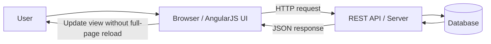
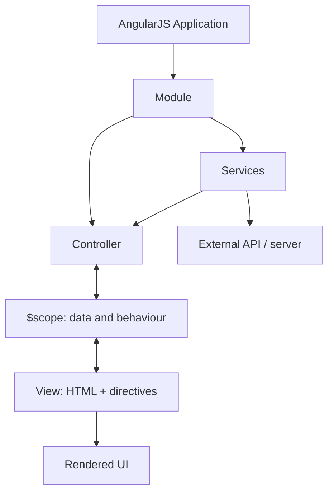
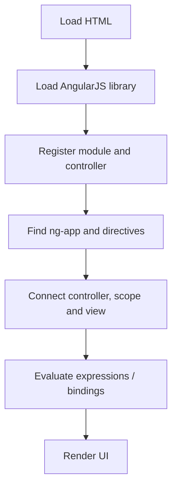
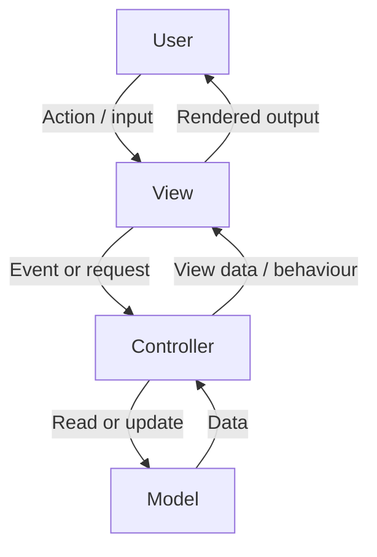
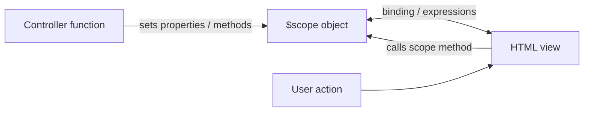
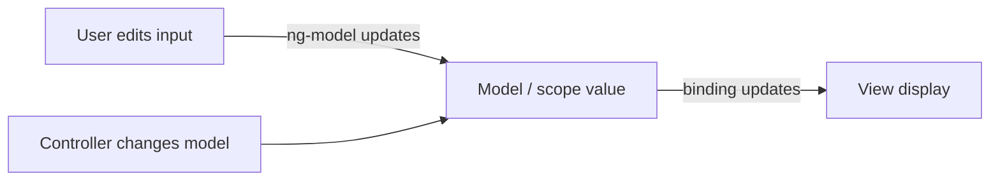
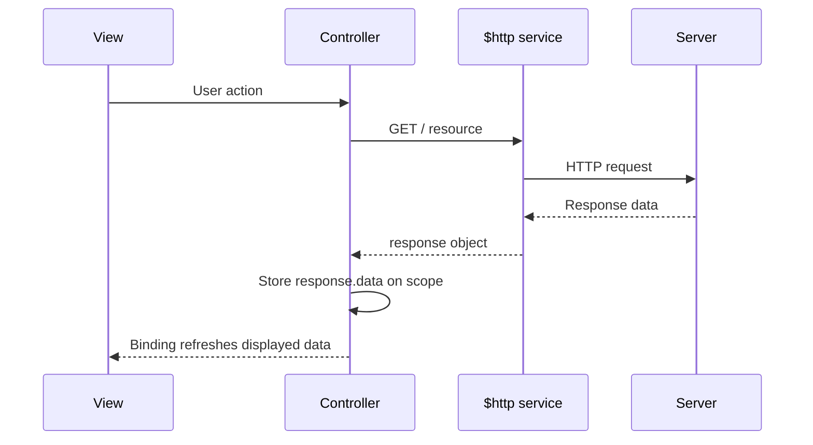
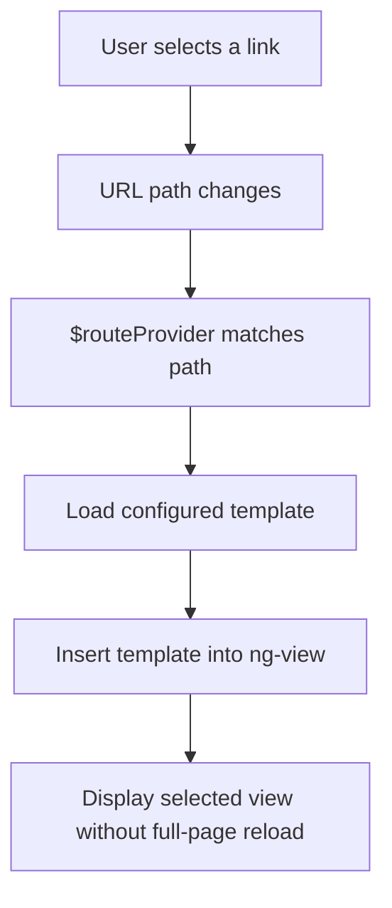
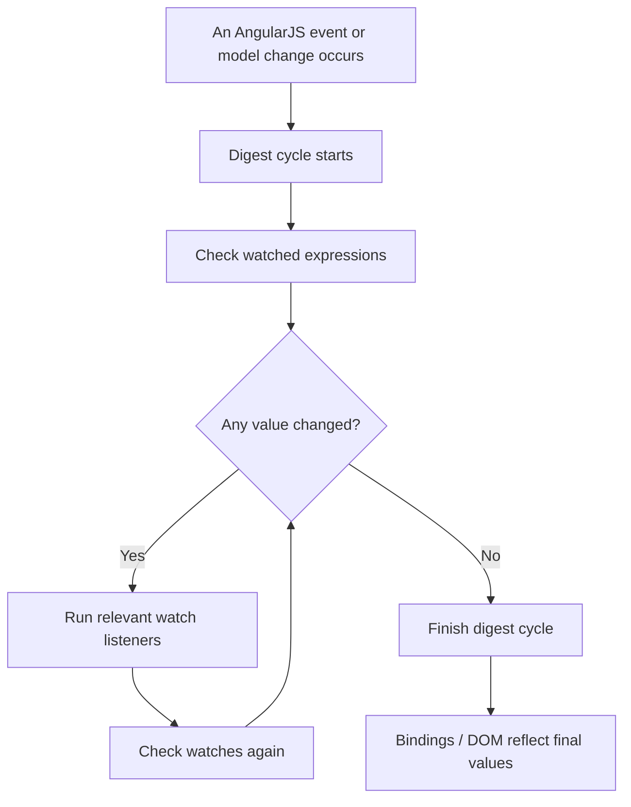

# AngularJS — Complete Study Notes
### M.Sc. Computer Applications | MEAN Stack
**Based on the two supplied PDFs:** *AngularJS* and *AngularJS Services*

> **Scope note:** These notes follow the topics and terminology in the supplied lecture PDFs. The examples use AngularJS 1.x syntax (the PDFs refer to version 1.6.9). AngularJS 1.x is a legacy framework and is different from modern Angular.

---

## Contents

1. Introduction to AngularJS
2. Single-Page Applications (SPA) and REST services
3. AngularJS architecture and MVC
4. Features, advantages and disadvantages
5. Modules, controllers and scope
6. Directives
7. Expressions and data binding
8. Common directives: `ng-app`, `ng-init`, `ng-model`, `ng-bind`, `ng-repeat`
9. Conditional display and events
10. Forms and validation
11. AngularJS services
12. Routing with `ngRoute`
13. Templates and dropdowns
14. Digest cycle
15. Worked examples
16. Quick revision tables
17. Exam questions

---

# 1. Introduction to AngularJS

## 1.1 Definition

**AngularJS** is an open-source JavaScript framework used to build dynamic web applications, especially Single-Page Applications (SPAs). It extends HTML with directives and provides features such as data binding, controllers, dependency injection, services, filters and routing.

The supplied notes describe AngularJS as a framework for Rich Internet Applications (RIAs), with an MVC-style structure and cross-browser support.

## 1.2 Why AngularJS?

In a traditional page, developers often write JavaScript to manually read input values, update HTML and keep the UI in sync with data. AngularJS provides declarative HTML directives and data binding to reduce this manual DOM work.

Example:

```html
<div ng-app="">
  <label>Name:</label>
  <input type="text" ng-model="name">
  <p>Hello, {{ name }}!</p>
</div>
```

When the user types into the input, the displayed greeting updates because `ng-model` and the expression use the same model value.

## 1.3 AngularJS in the MEAN stack

The MEAN stack is commonly described as:

| Technology | Main responsibility |
|---|---|
| MongoDB | Document database |
| Express.js | Server-side web framework |
| AngularJS / Angular | Client-side user interface |
| Node.js | JavaScript runtime for the server |

The lecture material specifically illustrates a browser-side Angular application communicating with a server and exchanging data, commonly in JSON format. A Single-Page Application does **not** have to be served by a Node.js backend; it can be hosted separately and communicate with any suitable API.

## 1.4 SPA request/response diagram



**Explanation:**
1. The browser loads the application page and AngularJS code.
2. The user interacts with the UI.
3. AngularJS can send an HTTP request to a server.
4. The server processes the request and may access a database.
5. The server returns data, often as JSON.
6. The UI updates using the returned data.

## 1.5 REST web services

A RESTful web service is accessed through HTTP requests. AngularJS applications can communicate with such services and exchange JSON data.

Common HTTP methods:

| Method | Typical purpose |
|---|---|
| `GET` | Retrieve data |
| `POST` | Create/submit data |
| `PUT` | Replace/update a resource |
| `PATCH` | Partially update a resource |
| `DELETE` | Delete a resource |

Example idea: a student-management UI requests `/api/students` with `GET`, receives JSON student records and displays them in a list.

---

# 2. AngularJS Application Architecture

## 2.1 Main building blocks

The lecture diagrams show an application containing modules, components, services and views. In AngularJS 1.x, the main concepts covered in these notes are:

- **Module:** Defines an application or a reusable feature area.
- **Controller:** Provides data and behaviour for a view.
- **Scope (`$scope`):** Connects controller data to the view.
- **View:** HTML enhanced with AngularJS directives and expressions.
- **Service:** Reusable logic or functionality that can be injected where needed.
- **Directive:** Adds AngularJS behaviour to HTML.
- **Filter:** Formats or selects data for display.
- **Route:** Selects a view based on the URL.



## 2.2 Page loading workflow

The supplied lecture notes describe the general sequence as follows:

1. The browser loads the HTML document.
2. The AngularJS JavaScript library is loaded.
3. Application/module and controller code is registered.
4. AngularJS scans the HTML for the application root and directives.
5. AngularJS connects the view with the relevant scope/controller.
6. Controller data becomes available to the view.
7. AngularJS evaluates expressions and updates the rendered page.



---

# 3. MVC Architecture

## 3.1 Definition

**MVC (Model–View–Controller)** is a software design pattern that separates an application into three responsibilities. This separation is intended to make application code easier to understand, maintain and test.

## 3.2 Three parts of MVC

| Part | Responsibility | Example in a student application |
|---|---|---|
| **Model** | Holds/manages data and application rules | Student name, roll number and marks |
| **View** | Displays information to the user | HTML form and student details |
| **Controller** | Handles user actions and coordinates data and view behaviour | Function that loads or updates student data |

## 3.3 MVC diagram



### Example

- The user types a student's name into the view.
- The controller receives the interaction through AngularJS binding.
- The model value changes.
- The view reflects the updated value.

AngularJS is often explained using MVC, although its practical design is also described as MVW (Model–View–Whatever) or as being similar to MVVM. For exams, use the terminology specified by your lecturer.

---

# 4. Features of AngularJS

The supplied PDFs identify these key features:

| Feature | Explanation |
|---|---|
| **Data binding** | Synchronises model data and the view. |
| **Scope** | Object that exposes data and methods to a view; it connects controller and view. |
| **Controllers** | JavaScript functions that provide view-related data and behaviour. |
| **Services** | Reusable injectable objects/functions; built-in examples include `$http` and `$location`. |
| **Filters** | Format displayed values or select items from collections. |
| **Directives** | Extend HTML with behaviour, such as `ng-model`, `ng-bind` and `ng-repeat`. |
| **Templates** | HTML view content populated with model data. |
| **Routing** | Switches the displayed view according to the URL without reloading the entire SPA. |
| **Deep linking** | Represents application state in a URL so it can be bookmarked or revisited. |
| **Dependency injection** | Supplies a component with the services/dependencies it needs. |
| **Testing support** | Components can be tested individually and through end-to-end tests. |

## 4.1 Dependency Injection (DI)

**Dependency Injection** is a technique in which an object or function receives the dependencies it needs instead of creating them itself.

Example:

```javascript
var app = angular.module('myApp', []);

app.controller('myCtrl', function ($scope, $http) {
  // $scope and $http are supplied by AngularJS
});
```

Here, the controller declares `$scope` and `$http` as dependencies. AngularJS provides them when it creates the controller.

### Benefits of DI
- Reduces tight coupling between components.
- Encourages reusable code.
- Makes testing easier because dependencies can be substituted or mocked.
- Centralises the creation and management of services.

## 4.2 Advantages

- Supports the development of Single-Page Applications.
- Provides data binding between HTML and application data.
- Encourages separation of concerns.
- Supports reusable services and components of logic.
- Can make UI code shorter by reducing manual DOM updates.
- Supports unit and end-to-end testing.
- Works in browsers that support the relevant JavaScript features.

## 4.3 Disadvantages and cautions

- AngularJS 1.x is a legacy framework; it should not be confused with modern Angular.
- A JavaScript-based UI is not a security boundary. Authentication, authorisation and validation must also be enforced on the server.
- If JavaScript is disabled, the AngularJS behaviour will not run.
- Poorly designed watchers, repeated work or large views can affect performance.
- The framework has a learning curve because developers must understand scope, directives, dependency injection and the digest cycle.

---

# 5. Modules, Controllers and Scope

## 5.1 Module

An AngularJS module groups the application components, such as controllers, services, filters and directives.

Create a module:

```javascript
var app = angular.module('myApp', []);
```

- `'myApp'` is the module name.
- `[]` is the list of module dependencies.
- An empty array means that no additional modules are declared as dependencies in this example.

Connect it to HTML:

```html
<div ng-app="myApp">
  <!-- AngularJS application content -->
</div>
```

## 5.2 Controller

A controller supplies data and functions that the view can use. The `ng-controller` directive associates a controller with part of the HTML.

```html
<div ng-app="myApp" ng-controller="myCtrl">
  <p>{{ firstName }} {{ lastName }}</p>
</div>

<script>
var app = angular.module('myApp', []);

app.controller('myCtrl', function ($scope) {
  $scope.firstName = 'John';
  $scope.lastName = 'Doe';
});
</script>
```

**Output:**
```text
John Doe
```

## 5.3 Scope (`$scope`)

The **scope** is a JavaScript object that exposes properties and functions to the view. In the lecture notes, it is described as the model that connects the view and controller.

```javascript
app.controller('myCtrl', function ($scope) {
  $scope.name = 'Amit';

  $scope.changeName = function () {
    $scope.name = 'Rahul';
  };
});
```

```html
<div ng-controller="myCtrl">
  <p>{{ name }}</p>
  <button ng-click="changeName()">Change name</button>
</div>
```

Before clicking, the displayed name is `Amit`. After clicking, it becomes `Rahul`.

### Controller–scope–view diagram



---

# 6. AngularJS Directives

## 6.1 Definition

**Directives** are special markers in HTML (often attributes beginning with `ng-`) that tell AngularJS to attach behaviour to an element or bind it to application data.

## 6.2 Important directives

| Directive | Purpose | Example |
|---|---|---|
| `ng-app` | Defines/initialises the AngularJS application root | `<div ng-app="myApp">` |
| `ng-init` | Initialises values in a view | `ng-init="name='Amit'"` |
| `ng-model` | Binds an input control to model data | `<input ng-model="name">` |
| `ng-bind` | Displays an expression value in an element | `<p ng-bind="name"></p>` |
| `ng-controller` | Associates a controller with an HTML region | `ng-controller="myCtrl"` |
| `ng-repeat` | Repeats an element for each item in a collection | `ng-repeat="student in students"` |
| `ng-click` | Runs an expression when an element is clicked | `ng-click="count=count+1"` |
| `ng-show` | Shows an element when the expression is true | `ng-show="isVisible"` |
| `ng-hide` | Hides an element when the expression is true | `ng-hide="isHidden"` |
| `ng-disabled` | Sets an element's disabled state | `ng-disabled="isDisabled"` |
| `ng-switch` | Chooses a displayed section based on an expression | `ng-switch="choice"` |
| `ng-options` | Generates options for a `<select>` control | `ng-options="x for x in items"` |
| `ng-view` | Placeholder for a route's view | `<div ng-view></div>` |

## 6.3 `ng-app`

`ng-app` marks the root of an AngularJS application and triggers its initialisation.

```html
<div ng-app="myApp">
  <!-- AngularJS-managed content -->
</div>
```

A named application must correspond to a module created in JavaScript. The shorthand `ng-app=""` is used in basic examples where a named module is not explicitly declared.

## 6.4 `ng-init`

`ng-init` initialises data in the HTML:

```html
<div ng-app="" ng-init="firstName='John'">
  <p ng-bind="firstName"></p>
</div>
```

Output: `John`

**Practical note:** `ng-init` is useful for small demonstrations and simple initial values. In larger applications, initialise application data in a controller or service.

## 6.5 `ng-model`

`ng-model` binds the value of an input, select or textarea control to application data.

```html
<div ng-app="">
  <input type="text" ng-model="studentName">
  <p>You entered: {{ studentName }}</p>
</div>
```

Typing in the input updates `studentName`; the expression then displays the new value.

## 6.6 `ng-bind`

`ng-bind` writes the evaluated value of an expression into an element.

```html
<div ng-app="" ng-init="name='Amit'">
  <p ng-bind="name"></p>
</div>
```

Output: `Amit`

## 6.7 `ng-repeat`

`ng-repeat` creates an HTML element for every item in an array or collection.

```html
<div ng-app="" ng-init="cities=['Pune','Jaipur','Mumbai']">
  <ul>
    <li ng-repeat="city in cities">{{ city }}</li>
  </ul>
</div>
```

Output:
- Pune
- Jaipur
- Mumbai

Object collection example:

```html
<div ng-app="" ng-init="students=[
  {name:'Asha', roll:1},
  {name:'Ravi', roll:2}
]">
  <p ng-repeat="s in students">
    {{ s.roll }} - {{ s.name }}
  </p>
</div>
```

---

# 7. AngularJS Expressions and Data Binding

## 7.1 Expressions

AngularJS expressions are written inside double curly braces: `{{ expression }}`. They evaluate a value and display it in the HTML.

Examples:

```html
<p>{{ 5 + 5 }}</p>
<p>{{ cost * quantity }}</p>
<p>{{ student.firstName + ' ' + student.lastName }}</p>
<p>{{ marks[3] }}</p>
```

If `cost = 30` and `quantity = 2`, the second expression displays `60`.

Expressions can work with:
- Numbers and operators
- Strings
- Object properties
- Array indexes
- Values exposed by the controller/scope

## 7.2 AngularJS expression vs JavaScript expression

| AngularJS expression | JavaScript expression |
|---|---|
| Commonly written directly in HTML as `{{ ... }}` | Written in JavaScript code |
| Evaluated against AngularJS scope/context | Evaluated in the JavaScript execution context |
| Supports AngularJS filters | Does not use AngularJS filter syntax directly |
| Not a substitute for general-purpose program logic | Supports general JavaScript language constructs |

Keep complex logic in controller/service code rather than putting it into a template expression.

## 7.3 Data binding

**Data binding** synchronises application data and the UI.

### One-way display binding
The model value is displayed in the view.

```html
<p>{{ name }}</p>
```

### Two-way binding with `ng-model`
The input updates the model, and changes to the model are reflected in the input.

```html
<input ng-model="name">
<p>{{ name }}</p>
```

### Two-way binding diagram



## 7.4 `ng-bind` vs interpolation

| `ng-bind` | `{{ expression }}` |
|---|---|
| Uses an HTML attribute | Uses curly braces in HTML text |
| Example: `<span ng-bind="name"></span>` | Example: `<span>{{ name }}</span>` |
| Often useful when you want the element's content set through a directive | Convenient for short inline expressions |

Both can display a value from AngularJS data.

---

# 8. Conditional Display and Event Directives

## 8.1 `ng-click`

Runs an AngularJS expression when the user clicks an element.

```html
<div ng-app="" ng-init="count=0">
  <button ng-click="count = count + 1">Increment</button>
  <p>Count: {{ count }}</p>
</div>
```

Every click increments `count` by one.

## 8.2 `ng-disabled`

Binds an element's disabled state to an expression.

```html
<div ng-app="" ng-init="locked=true">
  <button ng-disabled="locked">Submit</button>
  <label>
    <input type="checkbox" ng-model="locked">
    Lock button
  </label>
  <p>Locked: {{ locked }}</p>
</div>
```

When `locked` is `true`, the button is disabled. Unchecking the checkbox sets it to `false` and enables the button.

## 8.3 `ng-show` and `ng-hide`

- `ng-show="expression"`: shows the element when the expression is true.
- `ng-hide="expression"`: hides the element when the expression is true.

| Expression value | `ng-show` | `ng-hide` |
|---|---|---|
| `true` | Visible | Hidden |
| `false` | Hidden | Visible |

Example:

```html
<div ng-app="" ng-init="visible=false">
  <button ng-click="visible = !visible">Toggle message</button>
  <p ng-show="visible">AngularJS is visible.</p>
</div>
```

This toggles the visibility of the message.

## 8.4 `ng-switch`

`ng-switch` displays the matching section based on the value of an expression. It is useful when only one of several alternatives should be displayed.

```html
<div ng-app="" ng-init="choice='AngularJS'">
  <select ng-model="choice">
    <option>AngularJS</option>
    <option>MongoDB</option>
    <option>Node.js</option>
  </select>

  <div ng-switch="choice">
    <p ng-switch-when="AngularJS">AngularJS handles the client-side UI.</p>
    <p ng-switch-when="MongoDB">MongoDB stores documents.</p>
    <p ng-switch-when="Node.js">Node.js runs JavaScript on the server.</p>
    <p ng-switch-default>Select a topic.</p>
  </div>
</div>
```

## 8.5 Other event-listener directives

The supplied service/event PDF lists these examples:

| Directive | Event |
|---|---|
| `ng-click` | Mouse click |
| `ng-dblclick` | Double click |
| `ng-change` | Model value changes through an input |
| `ng-focus` | Element receives focus |
| `ng-blur` | Element loses focus |
| `ng-keydown` | Key is pressed down |
| `ng-keyup` | Key is released |
| `ng-keypress` | Key press event (legacy event behaviour varies) |
| `ng-mousedown` / `ng-mouseup` | Mouse button pressed/released |
| `ng-mouseenter` / `ng-mouseleave` | Pointer enters/leaves element |
| `ng-mousemove` / `ng-mouseover` | Pointer movement/over event |
| `ng-copy`, `ng-cut`, `ng-paste` | Clipboard-related events |

---

# 9. AngularJS Forms and Validation

## 9.1 Forms

AngularJS forms provide data binding and track the state of input controls such as:
- `input`
- `select`
- `textarea`
- `button`

`ng-model` connects a form control to application data.

```html
<div ng-app="" ng-init="firstName='Amit'">
  <form>
    <label>First name:</label>
    <input type="text" ng-model="firstName">
  </form>
  <p>Hello, {{ firstName }}!</p>
</div>
```

## 9.2 Checkbox

A checkbox usually represents a Boolean value (`true` or `false`).

```html
<div ng-app="">
  <input type="checkbox" ng-model="showHeader">
  <label>Show header</label>
  <h2 ng-show="showHeader">Student Portal</h2>
</div>
```

## 9.3 Radio buttons and select box

Radio buttons can share one `ng-model` while using different values. The selected value becomes the model value.

```html
<div ng-app="">
  <label><input type="radio" ng-model="topic" value="dogs"> Dogs</label>
  <label><input type="radio" ng-model="topic" value="cars"> Cars</label>
  <p>Selected: {{ topic }}</p>
</div>
```

A dropdown uses the selected option's value:

```html
<div ng-app="">
  <select ng-model="topic">
    <option value="">-- Select --</option>
    <option value="dogs">Dogs</option>
    <option value="cars">Cars</option>
  </select>
  <p>Selected: {{ topic }}</p>
</div>
```

## 9.4 Form validation

AngularJS tracks whether fields are valid, modified or visited. Validation can use HTML attributes or AngularJS directives.

Example:

```html
<div ng-app="">
  <form name="studentForm" novalidate>
    <label>Email:</label>
    <input type="email" name="email"
           ng-model="email" required>

    <p ng-show="studentForm.email.$touched &&
                studentForm.email.$invalid">
      Enter a valid email address.
    </p>

    <button ng-disabled="studentForm.$invalid">Submit</button>
  </form>
</div>
```

### Common validation attributes/directives

| Attribute/directive | Purpose |
|---|---|
| `required` / `ng-required` | Field must have a value |
| `type="email"` | Validates email-like input |
| `ng-minlength` | Minimum length |
| `ng-maxlength` | Maximum length |
| `ng-pattern` | Checks a regular-expression pattern |

### Form and input states

| Property | Meaning when true |
|---|---|
| `$untouched` | The control has not been touched/focused and left |
| `$touched` | The control has been touched |
| `$pristine` | The model value has not been changed by the user |
| `$dirty` | The model value has been changed |
| `$valid` | The control/form passes its validation rules |
| `$invalid` | The control/form fails at least one validation rule |
| `$error` | Object containing validation error information |

The same concepts appear as CSS classes such as `ng-touched`, `ng-untouched`, `ng-pristine`, `ng-dirty`, `ng-valid` and `ng-invalid`.

### Accessing validation properties

For a form named `studentForm` and an input named `email`:

- Form state: `studentForm.$valid`
- Input state: `studentForm.email.$valid`
- Input error details: `studentForm.email.$error`

**Security note:** Client-side validation improves user experience but does not secure data by itself. The server must validate incoming data too.

## 9.5 Resetting a form

The supplied notes demonstrate keeping a master object and copying it into the editable user object.

```javascript
var app = angular.module('myApp', []);

app.controller('formCtrl', function ($scope) {
  $scope.master = {
    firstName: 'Amit',
    lastName: 'Jain'
  };

  $scope.reset = function () {
    $scope.user = angular.copy($scope.master);
  };

  $scope.reset();
});
```

The view can bind fields to `user.firstName` and `user.lastName`, and call `reset()` from a button using `ng-click`.

---

# 10. AngularJS Services

## 10.1 Definition

A **service** is reusable functionality available within an AngularJS application. Services can be injected into controllers and other components that need them. The supplied PDF describes AngularJS built-in services and explains that services are commonly singleton instances.

### Why use services?
- Reuse logic across controllers.
- Separate data access and business logic from the view.
- Share functionality through dependency injection.
- Use AngularJS-aware APIs that work with its change-detection system.

## 10.2 Services overview

| Service | Purpose |
|---|---|
| `$location` | Reads or changes information about the current browser URL/location |
| `$http` | Sends HTTP requests and handles responses |
| `$timeout` | Runs a function once after a delay |
| `$interval` | Runs a function repeatedly at a time interval |

## 10.3 `$location` service

`$location` provides information about the current URL and can help work with URL parts. The PDF uses `$location.absUrl()` to read the full URL.

```javascript
var app = angular.module('myApp', []);

app.controller('customersCtrl', function ($scope, $location) {
  $scope.myUrl = $location.absUrl();
});
```

```html
<div ng-app="myApp" ng-controller="customersCtrl">
  <p>Current URL: {{ myUrl }}</p>
</div>
```

**Why use `$location` instead of directly using `window.location`?** `$location` is integrated with AngularJS and its routing/change-detection behaviour.

## 10.4 `$http` service

`$http` sends HTTP requests to a server and makes the response available to the application.

Example from the lecture topic:

```javascript
var app = angular.module('myApp', []);

app.controller('myCtrl', function ($scope, $http) {
  $http.get('welcome.htm')
    .then(function (response) {
      $scope.myWelcome = response.data;
    });
});
```

```html
<div ng-app="myApp" ng-controller="myCtrl">
  <p>{{ myWelcome }}</p>
</div>
```

### `$http` request workflow



Important points:
- `get()` sends a GET request.
- `.then()` handles a successful promise resolution.
- `response.data` contains the response body.
- Production code should also handle errors, for example with a rejection callback or `.catch()`.

Example with basic error handling:

```javascript
app.controller('myCtrl', function ($scope, $http) {
  $scope.errorMessage = '';

  $http.get('/api/students')
    .then(function (response) {
      $scope.students = response.data;
    })
    .catch(function () {
      $scope.errorMessage = 'Could not load students.';
    });
});
```

## 10.5 `$timeout` service

`$timeout` is AngularJS's service-based counterpart to `window.setTimeout`. It runs a function once after a specified delay, measured in milliseconds.

```javascript
var app = angular.module('myApp', []);

app.controller('myCtrl', function ($scope, $timeout) {
  $scope.message = 'Hello World!';

  $timeout(function () {
    $scope.message = 'How are you today?';
  }, 2000);
});
```

After approximately two seconds, the message changes.

## 10.6 `$interval` service

`$interval` is AngularJS's service-based counterpart to `window.setInterval`. It repeatedly executes a function at a specified interval.

```javascript
var app = angular.module('myApp', []);

app.controller('myCtrl', function ($scope, $interval) {
  $scope.theTime = new Date().toLocaleTimeString();

  $interval(function () {
    $scope.theTime = new Date().toLocaleTimeString();
  }, 1000);
});
```

The displayed time is updated approximately once per second.

## 10.7 `$timeout` vs `$interval`

| `$timeout` | `$interval` |
|---|---|
| Runs once after a delay | Runs repeatedly |
| Similar to `setTimeout()` | Similar to `setInterval()` |
| Example: show a message after 2 seconds | Example: update a clock every second |
| Delay is in milliseconds | Interval is in milliseconds |

---

# 11. Routing with `ngRoute`

## 11.1 Definition

**Routing** maps a URL path to a view. The `ngRoute` module allows an AngularJS SPA to show different views without reloading the entire application page.

## 11.2 Main routing parts

| Part | Responsibility |
|---|---|
| `ngRoute` | Adds routing functionality |
| `$routeProvider` | Configures URL-to-view mappings |
| `.when(path, config)` | Defines what to display for a path |
| `templateUrl` | Names the HTML template to load |
| `ng-view` | Placeholder where the selected route's view is displayed |

## 11.3 Routing flow



## 11.4 Include the route module

The AngularJS core library and the route module are separate scripts in the lecture examples:

```html
<script src="https://ajax.googleapis.com/ajax/libs/angularjs/1.6.9/angular.min.js"></script>
<script src="https://ajax.googleapis.com/ajax/libs/angularjs/1.6.9/angular-route.js"></script>
```

The versions of the core library and route module should match.

## 11.5 Configure routes

```html
<body ng-app="myApp">
  <a href="#!/ ">Main</a>
  <a href="#!/red">Red</a>
  <a href="#!/green">Green</a>

  <div ng-view></div>

  <script>
    var app = angular.module('myApp', ['ngRoute']);

    app.config(function ($routeProvider) {
      $routeProvider
        .when('/', {
          templateUrl: 'main.htm'
        })
        .when('/red', {
          templateUrl: 'red.htm'
        })
        .when('/green', {
          templateUrl: 'green.htm'
        })
        .otherwise({
          redirectTo: '/'
        });
    });
  </script>
</body>
```

**URL note:** The lecture slides show the AngularJS hash-bang route style, such as `#!/red`. Keep link syntax consistent with the configured routing mode and AngularJS version.

### Example files
- `main.htm` — main view
- `red.htm` — red view
- `green.htm` — green view

When the route matches `/red`, AngularJS loads `red.htm` into the `ng-view` placeholder.

---

# 12. Templates and Dropdowns

## 12.1 `ng-template`

The supplied service PDF describes `ng-template` usage through a `<script>` element with `type="text/ng-template"`. AngularJS can store that template in `$templateCache` and use it as a template.

Example:

```html
<script type="text/ng-template" id="studentTemplate.html">
  <h2>{{ student.name }}</h2>
  <p>Roll number: {{ student.roll }}</p>
</script>
```

The template can be referenced by template-related features when configured appropriately.

## 12.2 `ng-options`

`ng-options` generates options for a `<select>` control from an array or collection.

```html
<div ng-app="" ng-init="courses=['Python','AngularJS','MongoDB']">
  <select ng-model="selectedCourse"
          ng-options="course for course in courses">
    <option value="">-- Select a course --</option>
  </select>
  <p>Selected course: {{ selectedCourse }}</p>
</div>
```

The lecture notes compare `ng-options` with `ng-repeat` for dropdowns and note that `ng-options` can avoid creating a separate scope for each repeated option, which may reduce overhead.

---

# 13. Digest Cycle

## 13.1 Definition

The **digest cycle** is AngularJS's change-detection process. It checks watched values, compares current values with previous values and runs watch listeners when changes are detected. AngularJS then updates the relevant bindings in the DOM.

The supplied PDF calls the comparison of current and previous values **dirty checking**.

## 13.2 Digest-cycle diagram



## 13.3 Why can multiple checks occur?

A watch listener may itself change another watched value. AngularJS checks again to see whether more changes occurred. The supplied notes state that the digest can perform multiple iterations, with a maximum of 10 iterations in the described behaviour; excessive changes can cause an error.

Example concept:
1. An event changes variable `b`.
2. The digest detects the change.
3. A listener changes variable `a`.
4. Another check detects the change in `a`.
5. When no further watched values change, the cycle completes.

## 13.4 Practical implications

- Avoid expensive work in frequently evaluated expressions or watchers.
- Avoid creating chains of watchers that repeatedly change one another.
- Prefer clear controller/service logic.
- Use AngularJS-aware services such as `$timeout` and `$interval` when working within AngularJS, because they integrate with the framework's update cycle.

---

# 14. Complete Worked Example

This small example combines a module, controller, scope, input binding, click event, conditional display and list rendering.

```html
<!DOCTYPE html>
<html>
<head>
  <meta charset="utf-8">
  <title>AngularJS Student Demo</title>
  <script src="https://ajax.googleapis.com/ajax/libs/angularjs/1.6.9/angular.min.js"></script>
</head>
<body ng-app="studentApp" ng-controller="studentCtrl">

  <h1>Student Demo</h1>

  <label>Student name:</label>
  <input type="text" ng-model="studentName">

  <p>Hello, {{ studentName }}!</p>

  <button ng-click="addStudent()">Add student</button>
  <button ng-click="showList = !showList">Toggle list</button>

  <p ng-show="showList">Students:</p>
  <ul ng-show="showList">
    <li ng-repeat="student in students track by $index">
      {{ student }}
    </li>
  </ul>

  <script>
    var app = angular.module('studentApp', []);

    app.controller('studentCtrl', function ($scope) {
      $scope.studentName = 'Amit';
      $scope.students = ['Amit', 'Neha'];
      $scope.showList = true;

      $scope.addStudent = function () {
        if ($scope.studentName &&
            $scope.students.indexOf($scope.studentName) === -1) {
          $scope.students.push($scope.studentName);
        }
      };
    });
  </script>
</body>
</html>
```

### What this example demonstrates

- `ng-app` identifies the application.
- `ng-controller` connects the view to `studentCtrl`.
- `$scope` exposes `studentName`, `students`, `showList` and `addStudent()`.
- `ng-model` binds the input to `studentName`.
- `{{ studentName }}` displays the current value.
- `ng-click` calls functions or evaluates expressions after a click.
- `ng-show` controls visibility.
- `ng-repeat` displays one list item for each student.

---

# 15. Quick Revision Tables

## 15.1 Important AngularJS syntax

| Syntax | Meaning |
|---|---|
| `ng-app="myApp"` | Start/identify the application |
| `ng-controller="myCtrl"` | Associate a controller with a view region |
| `ng-init="count=0"` | Initialise a value |
| `ng-model="name"` | Bind a form control to data |
| `ng-bind="name"` | Display a value inside an element |
| `{{ name }}` | Display an expression |
| `ng-repeat="x in items"` | Repeat an element for each item |
| `ng-click="save()"` | Call a function on click |
| `ng-show="visible"` | Show when true |
| `ng-hide="hidden"` | Hide when true |
| `ng-disabled="locked"` | Disable when true |
| `ng-switch="choice"` | Choose a section based on a value |
| `ng-view` | Route-view placeholder |

## 15.2 Important services

| Service | Remember |
|---|---|
| `$location` | Current URL/location information |
| `$http` | HTTP communication with a server |
| `$timeout` | One delayed execution |
| `$interval` | Repeated execution |

## 15.3 Important differences

| Comparison | Difference |
|---|---|
| `ng-model` vs `ng-bind` | `ng-model` binds form-control values; `ng-bind` displays a value in an element. |
| `ng-show` vs `ng-hide` | `ng-show` displays when true; `ng-hide` hides when true. |
| `$timeout` vs `$interval` | `$timeout` runs once; `$interval` repeats. |
| Model vs View | Model represents application data; view presents information. |
| Controller vs Service | Controller coordinates view-related behaviour; service provides reusable functionality. |
| `ng-repeat` vs `ng-options` | `ng-repeat` repeats HTML elements; `ng-options` generates `<select>` options. |
| `$valid` vs `$invalid` | `$valid` means validation passes; `$invalid` means at least one rule fails. |
| `$pristine` vs `$dirty` | `$pristine` means unchanged; `$dirty` means the value has been changed. |
| `$untouched` vs `$touched` | `$untouched` means not yet touched; `$touched` means the control has been touched. |

---

# 16. Exam-Oriented Questions

## Short-answer questions (2–3 marks)

1. Define AngularJS.
2. What is a Single-Page Application?
3. Define MVC architecture.
4. What is a directive? Give four examples.
5. What is the purpose of `ng-app`?
6. Explain `ng-model` and `ng-bind`.
7. What is `$scope`?
8. What is dependency injection?
9. Define an AngularJS service.
10. What is the purpose of `$http`?
11. Differentiate `$timeout` and `$interval`.
12. What is routing? What is `ngRoute`?
13. What is the digest cycle?
14. What is dirty checking?
15. Explain the `$valid`, `$invalid`, `$pristine` and `$dirty` states.

## Long-answer questions (5–8 marks)

1. Explain the features, advantages and disadvantages of AngularJS.
2. Explain MVC architecture with a labelled diagram.
3. Explain AngularJS modules, controllers and scope with an example.
4. Explain directives with examples of `ng-app`, `ng-init`, `ng-model`, `ng-bind` and `ng-repeat`.
5. Explain two-way data binding with a suitable example and diagram.
6. Explain AngularJS form validation and the different form/input states.
7. Explain AngularJS services and describe `$location`, `$http`, `$timeout` and `$interval`.
8. Explain routing in AngularJS using `ngRoute`, `$routeProvider`, `templateUrl` and `ng-view`.
9. Explain the digest cycle and dirty checking with a flowchart.
10. Explain how AngularJS communicates with REST web services.

## Practical/programming questions

1. Create a page that accepts a name and displays it using `ng-model`.
2. Write an AngularJS program to increment a counter using `ng-click`.
3. Use `ng-repeat` to display an array of city names.
4. Use `ng-show` and `ng-hide` to control the visibility of a message.
5. Create a form that validates a required email field.
6. Use `$timeout` to change a message after two seconds.
7. Use `$interval` to display the current time every second.
8. Use `$http.get()` to retrieve data and display the response.
9. Configure three routes and display them inside `ng-view`.
10. Create a dropdown using `ng-options`.

---

# 17. Last-Minute Revision

- AngularJS is a JavaScript framework for dynamic browser applications and SPAs.
- MVC stands for **Model, View, Controller**.
- `ng-app` starts/identifies the AngularJS application.
- `ng-controller` associates a controller with a view.
- `$scope` exposes controller data and functions to the view.
- `ng-model` binds form controls to model data.
- `ng-bind` and `{{ }}` display evaluated values.
- `ng-repeat` repeats HTML for each collection item.
- `ng-click` responds to click events.
- `ng-show` shows when true; `ng-hide` hides when true.
- `$http` communicates with a server.
- `$location` provides URL/location information.
- `$timeout` executes once after a delay; `$interval` executes repeatedly.
- `ngRoute` maps URL paths to templates; `ng-view` is the placeholder for the routed view.
- Form states include `$valid`, `$invalid`, `$pristine`, `$dirty`, `$touched` and `$untouched`.
- The digest cycle checks watched values and updates bindings after changes.
- Client-side validation is not a replacement for server-side validation.

---

## Source coverage

Prepared from the uploaded lecture PDFs:
- **`angularjs(5).pdf`** — AngularJS overview, SPA/REST diagram, MVC, features, directives, expressions, modules, controllers, scope and related topics.
- **`angularjs_services(5).pdf`** — services, events, forms and validation, templates, dropdowns, routing and digest cycle.

Where a slide's sample code contained typographical inconsistencies, the examples above use consistent AngularJS 1.x syntax while preserving the concept taught in the slides.
