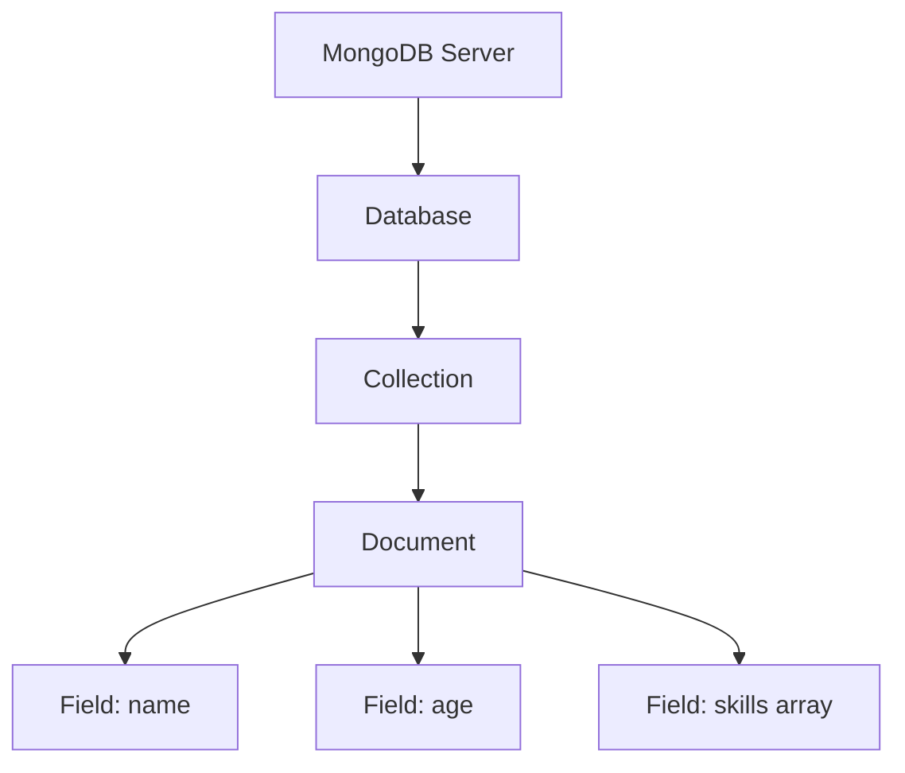
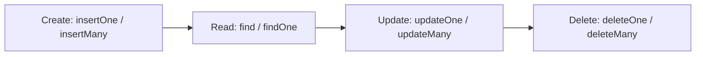
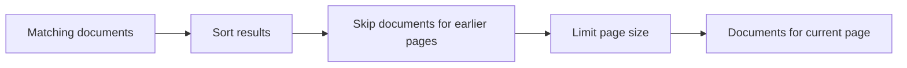
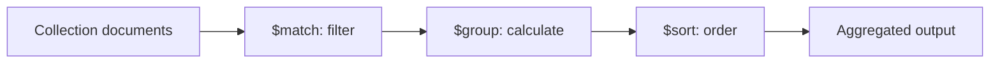

# MongoDB — Complete Study Notes
### M.Sc. Computer Applications | MEAN Stack

**Prepared from the supplied lecture PDFs:** `mongdb_1(3).pdf` and `mongdb_2(3).pdf`.

> **Important source note:** These notes follow the concepts, terminology, and examples in the lecture PDFs. Some slides use older shell methods such as `insert()`, `update()`, `remove()`, `ensureIndex()` and `url.parse()`-style legacy patterns. Where useful, modern alternatives are shown separately. The second PDF lists change streams, replication and storage in its contents, but does not explain these topics in detail; they are therefore not expanded as if the slides had covered them.

---

## Contents

1. Introduction to MongoDB
2. SQL vs NoSQL
3. MongoDB structure and terminology
4. BSON and data types
5. Advantages and NoSQL database types
6. Data modelling
7. Creating and dropping databases and collections
8. CRUD operations
9. Query and comparison operators
10. Array operators
11. Projection
12. Limit and skip
13. Sorting
14. Aggregation
15. Indexing
16. Quick revision tables
17. Exam-oriented questions

---

# 1. Introduction to MongoDB

## 1.1 What is MongoDB?

**MongoDB** is a NoSQL, document-oriented database. It stores data as documents made up of field–value pairs. Documents are grouped into collections, and collections are stored inside databases.

MongoDB represents documents in a JSON-like form, while its storage and communication format is **BSON** (Binary JSON).

Example document:

```javascript
{
  name: "Asha",
  age: 22,
  course: "MSc CA",
  skills: ["Python", "MongoDB", "SQL"]
}
```

Unlike a traditional relational table, documents in the same collection do not have to contain exactly the same fields.

## 1.2 What is a NoSQL database?

NoSQL generally refers to database systems that do not rely exclusively on the traditional relational-table model. They are often designed for flexible data models, distributed storage, and large or varied datasets.

The lecture material highlights situations where data may be structured, semi-structured, unstructured, diverse or distributed across cloud systems.

## 1.3 Structured vs unstructured data

| Structured data | Unstructured data |
|---|---|
| Follows a defined structure, often rows and columns | Does not follow one fixed tabular structure |
| Easier to represent in tables | May include documents, images, audio, video and other formats |
| Example: student ID, name and marks in a table | Example: a collection of text documents and media files |

Applications may use both structured and unstructured data. A database should be selected based on the application's access patterns and data requirements.

---

# 2. SQL vs NoSQL

The first lecture PDF contains a comparison table on pages 1–2.

| Basis | SQL / Relational database | NoSQL database |
|---|---|---|
| Data model | Tables with rows and columns | Document, key–value, graph or wide-column models |
| Schema | Usually predefined or fixed | Often flexible, depending on the database |
| Data representation | Relational tables | Depends on the NoSQL model |
| Querying | SQL | Database-specific query methods/languages |
| Scaling | Traditionally associated with vertical scaling; many systems also support horizontal scaling | Often designed with horizontal scaling in mind |
| Relationships | Commonly represented with keys and joins | May use embedded data, references or database-specific relationships |
| Typical examples | MySQL, Oracle, SQLite, PostgreSQL, SQL Server | MongoDB, Redis, Cassandra, CouchDB, Neo4j |

**Exam note:** The table reflects the broad comparison used in the lecture slides. Avoid treating it as an absolute rule: modern relational and NoSQL databases can support multiple scaling and query strategies.

---

# 3. MongoDB Structure and Terminology

## 3.1 Database, collection, document and field

| MongoDB term | Meaning | Relational database equivalent |
|---|---|---|
| Database | Container for collections | Database |
| Collection | Group of related documents | Table |
| Document | Set of field–value pairs | Row / record |
| Field | A named value inside a document | Column / attribute |
| Embedded document | A document stored inside another document | Often compared with related/joined data, though not identical |
| `_id` | Unique identifier for a document within a collection | Commonly compared with a primary key |

### Hierarchy diagram



The hierarchy is:

**Database → Collection → Document → Field**

## 3.2 Example

```javascript
{
  _id: 101,
  name: "Ravi",
  age: 23,
  address: {
    city: "Pune",
    state: "Maharashtra"
  }
}
```

In this document:
- `_id`, `name`, `age` and `address` are fields.
- `address` is an embedded document.
- `city` and `state` are fields inside the embedded document.

MongoDB usually generates an `_id` value automatically if one is not supplied.

---

# 4. BSON and MongoDB Data Types

## 4.1 JSON vs BSON

**JSON** is a text-based data interchange format. **BSON** is a binary-encoded representation used by MongoDB. BSON supports additional data types and is designed for efficient encoding and decoding.

| JSON-style value | Example |
|---|---|
| String | `"name": "Asha"` |
| Number | `"age": 22` |
| Boolean | `"active": true` |
| Array | `"skills": ["Python", "SQL"]` |
| Object / embedded document | `"address": {"city": "Pune"}` |
| Null | `"middleName": null` |

The lecture PDF specifically discusses integer, Boolean, double, string, array, object and date examples. MongoDB/BSON also supports types such as ObjectId, binary data, timestamps and others.

## 4.2 Examples

```javascript
// String
{ name: "Asha" }

// Integer / number
{ age: 22 }

// Boolean
{ isStudent: true }

// Double
{ percentage: 89.5 }

// Array
{ degrees: ["BCA", "MCA"] }

// Embedded document
{
  marks: {
    English: 94,
    ComputerScience: 96,
    Mathematics: 80
  }
}

// Date
{ admissionDate: ISODate("2026-06-01T00:00:00Z") }
```

**Note:** The exact numeric representation depends on the client, shell and BSON type used.

---

# 5. Advantages of MongoDB

The lecture slides list the following advantages:

1. **Document-oriented storage:** Data is stored in a readable, JSON-like document structure.
2. **Flexible schema:** Documents in one collection can have different fields.
3. **Replication and high availability:** Replica sets can maintain multiple copies of data.
4. **Sharding:** Data can be distributed across machines for horizontal scaling.
5. **Ad hoc queries:** Supports filtering by fields, ranges and other query conditions.
6. **Indexing:** Indexes can improve search performance.
7. **Rich query capabilities:** Supports operators and aggregation.
8. **Efficient updates:** Individual fields can be updated without replacing the entire document.
9. **Language integration:** Drivers allow applications written in different programming languages to access the database.

## 5.1 Common NoSQL database types

| Type | How data is represented | Examples from the lecture |
|---|---|---|
| Document database | Documents with field–value pairs | MongoDB |
| Key–value store | Values indexed by keys | Redis |
| Graph database | Nodes and relationships | Neo4j |
| Wide-column store | Data grouped into column families | Cassandra, HBase |

---

# 6. Data Modelling in MongoDB

## 6.1 Definition

**Data modelling** is the process of designing how an application's data will be structured and related in the database.

MongoDB supports a flexible schema. The lecture advises designing the schema around user requirements, common access patterns, performance and the data that is frequently used together.

### Guidelines from the lecture

- Design the schema according to user requirements.
- Combine objects that are usually used together.
- Keep separate data separate when it is accessed independently.
- Optimise for frequent use cases.
- Consider aggregation requirements.
- Duplicate data only where the trade-off is justified.

## 6.2 Two data models

The PDF describes two models:

1. Embedded data model (denormalized)
2. Normalized data model (references)

### A. Embedded data model

Related data is stored together in one document.

```javascript
{
  _id: 1001,
  empId: "10025AE336",
  personalDetails: {
    firstName: "Radhika",
    lastName: "Sharma",
    dateOfBirth: "1995-09-26"
  },
  contact: {
    email: "radhika@example.com",
    phone: "9848022338"
  },
  address: {
    city: "Hyderabad",
    area: "Madhapur",
    state: "Telangana"
  }
}
```

**Advantages**
- Related information can be retrieved in one document read.
- The structure is convenient when related data is usually accessed together.

**Considerations**
- Repeated or frequently changing embedded data may be harder to maintain.
- Documents have size limits, so unbounded arrays should be avoided.

### B. Normalized data model

Related data is stored in separate documents and connected using references.

**Employee collection**

```javascript
{
  _id: "EMP101",
  empId: "10025AE336"
}
```

**Personal details collection**

```javascript
{
  _id: "PD101",
  employeeId: "EMP101",
  firstName: "Radhika",
  lastName: "Sharma",
  dateOfBirth: "1995-09-26"
}
```

**Contact collection**

```javascript
{
  _id: "CON101",
  employeeId: "EMP101",
  email: "radhika@example.com",
  phone: "9848022338"
}
```

**Advantages**
- Avoids unnecessary duplication.
- Useful when related data is large, independently updated or shared.

**Considerations**
- The application may need multiple queries or an aggregation using `$lookup` to retrieve related information.

### Embedded vs normalized

| Embedded model | Normalized model |
|---|---|
| Related data stored in one document | Related data stored in separate documents |
| Often fewer reads for related data | May require additional queries |
| Can duplicate data | Can reduce duplication |
| Suitable when data is accessed together | Suitable when data is accessed independently or shared |

## 6.3 Example: blog post data model

The lecture gives a blog post example with a title, description, publisher, URL, tags, likes and comments.

```javascript
{
  _id: "POST101",
  title: "Introduction to MongoDB",
  description: "MongoDB basics",
  by: "Asha",
  url: "/mongodb-basics",
  tags: ["database", "NoSQL", "MongoDB"],
  likes: 25,
  comments: [
    {
      user: "Ravi",
      message: "Useful explanation",
      dateCreated: ISODate("2026-10-20T10:00:00Z"),
      likes: 3
    },
    {
      user: "Neha",
      message: "Good examples",
      dateCreated: ISODate("2026-10-21T11:00:00Z"),
      likes: 2
    }
  ]
}
```

This example demonstrates arrays and embedded documents.

---

# 7. Creating and Dropping Databases and Collections

The examples in this section use the MongoDB shell style shown in the lecture material.

## 7.1 Select or create a database

```javascript
use my_project_db
```

`use` switches to the named database. The database is generally created physically when data is first stored in it.

## 7.2 Show databases

```javascript
show dbs
```

A newly selected database may not appear until data has been stored.

## 7.3 Check the current database

```javascript
db
```

## 7.4 Insert data to create a collection

```javascript
db.movie.insertOne({
  name: "Avengers: Endgame"
})
```

If `movie` does not exist, MongoDB creates the collection when the document is inserted.

The lecture also uses the older syntax:

```javascript
db.movie.insert({ name: "Avengers: Endgame" })
```

## 7.5 Drop the current database

```javascript
db.dropDatabase()
```

This drops the database currently selected by `use`. **Use this command carefully:** it removes the database and its data.

## 7.6 Create a collection explicitly

```javascript
db.createCollection("MyCollection")
```

## 7.7 List collections

```javascript
show collections
```

## 7.8 Drop a collection

```javascript
db.MyCollection.drop()
```

---

# 8. CRUD Operations

**CRUD** stands for:

- **C — Create:** Insert documents.
- **R — Read:** Retrieve documents.
- **U — Update:** Modify documents.
- **D — Delete:** Remove documents.



Use the following sample collection for practice:

```javascript
db.students.insertMany([
  { regNo: "3014", name: "Asha", age: 21, course: "MCA", marks: 85 },
  { regNo: "3015", name: "Ravi", age: 22, course: "MCA", marks: 72 },
  { regNo: "3016", name: "Neha", age: 23, course: "MSc CA", marks: 91 }
])
```

## 8.1 Create / Insert

### Insert one document

```javascript
db.students.insertOne({
  regNo: "3017",
  name: "Karan",
  age: 22,
  course: "MSc CA",
  marks: 78
})
```

### Insert multiple documents

```javascript
db.students.insertMany([
  { regNo: "3018", name: "Meera", age: 21, marks: 88 },
  { regNo: "3019", name: "Dev", age: 22, marks: 69 }
])
```

The lecture also demonstrates the older `insert()` method for one or many documents.

## 8.2 Read / Find

### Find all documents

```javascript
db.students.find()
```

### Find one document

```javascript
db.students.findOne({ regNo: "3014" })
```

### Find documents matching a condition

```javascript
db.students.find({ regNo: "3014" })
```

### Find using multiple conditions

```javascript
db.students.find({
  course: "MCA",
  marks: { $gte: 75 }
})
```

When multiple field conditions are specified in the same query document, they are combined with AND semantics.

## 8.3 Update

### Update one document

```javascript
db.students.updateOne(
  { regNo: "3014" },
  { $set: { name: "Asha Sharma" } }
)
```

`$set` changes the specified field and leaves other fields unchanged.

### Increment a numeric value

```javascript
db.students.updateOne(
  { regNo: "3014" },
  { $inc: { marks: 2 } }
)
```

### Update multiple matching documents

```javascript
db.students.updateMany(
  { course: "MCA" },
  { $set: { department: "Computer Applications" } }
)
```

The source slides show the older `update()` method. For modern examples, prefer `updateOne()` or `updateMany()` to make the intended scope explicit.

## 8.4 Delete

### Delete one matching document

```javascript
db.students.deleteOne({ regNo: "3014" })
```

If multiple documents match, `deleteOne()` deletes only one of them.

### Delete all documents matching a condition

```javascript
db.students.deleteMany({ course: "MCA" })
```

### Delete all documents in a collection

```javascript
db.students.deleteMany({})
```

This removes all documents but keeps the collection itself.

The lecture also shows the older `remove()` method:

```javascript
db.programmers.remove({})
```

**Important:** `deleteMany({})` is destructive. Check the filter and the selected database before executing delete commands.

---

# 9. MongoDB Query and Comparison Operators

Comparison operators allow queries to test field values.

| Operator | Meaning | Example |
|---|---|---|
| `$eq` | Equal to | `{ age: { $eq: 22 } }` |
| `$ne` | Not equal to | `{ age: { $ne: 22 } }` |
| `$gt` | Greater than | `{ marks: { $gt: 80 } }` |
| `$gte` | Greater than or equal to | `{ marks: { $gte: 80 } }` |
| `$lt` | Less than | `{ age: { $lt: 23 } }` |
| `$lte` | Less than or equal to | `{ age: { $lte: 23 } }` |
| `$in` | Matches any value in a supplied array | `{ course: { $in: ["MCA", "MSc CA"] } }` |
| `$nin` | Does not match values in the supplied array | `{ course: { $nin: ["MCA"] } }` |

### Examples

```javascript
// Marks greater than 80
db.students.find({ marks: { $gt: 80 } })

// Age 22 or older
db.students.find({ age: { $gte: 22 } })

// Course is MCA or MSc CA
db.students.find({ course: { $in: ["MCA", "MSc CA"] } })
```

## 9.1 Logical operators

| Operator | Meaning |
|---|---|
| `$and` | All specified conditions must be true |
| `$or` | At least one condition must be true |
| `$nor` | None of the conditions must be true |
| `$not` | Inverts the effect of a query expression |

Examples:

```javascript
// AND: marks >= 75 and age <= 22
db.students.find({
  $and: [
    { marks: { $gte: 75 } },
    { age: { $lte: 22 } }
  ]
})

// OR: course is MCA or marks > 90
db.students.find({
  $or: [
    { course: "MCA" },
    { marks: { $gt: 90 } }
  ]
})

// Equivalent simple AND conditions can be written directly
db.students.find({ age: { $gte: 21 }, marks: { $gt: 70 } })
```

## 9.2 Array query operators

| Operator | Purpose |
|---|---|
| `$all` | Matches arrays containing all specified values |
| `$size` | Matches arrays with the specified number of elements |
| `$elemMatch` | Matches an array when at least one element satisfies multiple conditions |

Example data:

```javascript
db.users.insertOne({
  name: "Asha",
  tags: ["developer", "programmer", "techwriter"],
  scores: [
    { subject: "DBMS", marks: 85 },
    { subject: "Python", marks: 92 }
  ]
})
```

Queries:

```javascript
// Array contains both values
db.users.find({ tags: { $all: ["developer", "programmer"] } })

// Array contains exactly 3 elements
db.users.find({ tags: { $size: 3 } })

// One score object must satisfy both conditions
db.users.find({
  scores: {
    $elemMatch: { subject: "Python", marks: { $gte: 90 } }
  }
})
```

---

# 10. Projection Queries

**Projection** specifies which fields should be returned in the query result.

Syntax:

```javascript
db.collection.find(filter, projection)
```

- `1` includes a field.
- `0` excludes a field.
- `_id` is included by default unless explicitly excluded.
- In ordinary inclusion/exclusion projections, do not mix inclusion and exclusion fields, except for `_id`.

Example collection:

```javascript
{
  title: "Networking",
  description: "Networking Essentials",
  author: "Gaurav Mandes"
}
```

### Return only `author` and `title`

```javascript
db.writers.find(
  { author: "Gaurav Mandes" },
  { _id: 0, author: 1, title: 1 }
)
```

This returns only the `author` and `title` fields and excludes `_id`.

### Exclude a field

```javascript
db.students.find({}, { marks: 0 })
```

This returns documents without the `marks` field.

---

# 11. Limit and Skip

## 11.1 `limit()`

`limit()` restricts the number of documents returned.

Syntax:

```javascript
db.collection.find().limit(number)
```

Example:

```javascript
db.students.find().limit(2)
```

Returns at most two documents.

## 11.2 `skip()`

`skip()` skips a specified number of documents before returning the remaining results.

```javascript
db.students.find().skip(2)
```

## 11.3 Combine `sort()`, `skip()` and `limit()`

```javascript
db.students.find()
  .sort({ marks: -1 })
  .skip(1)
  .limit(2)
```

This sorts by marks from highest to lowest, skips the first result, and returns the next two.

### Pagination diagram



For consistent pagination, sort by a field or combination of fields that produces a stable order, often including `_id` as a tie-breaker.

---

# 12. Sorting Records

The `sort()` method orders documents based on one or more fields.

Syntax:

```javascript
db.collection.find().sort({ fieldName: 1 })
```

- `1` means ascending order.
- `-1` means descending order.

### Examples

```javascript
// Marks from low to high
db.students.find().sort({ marks: 1 })

// Marks from high to low
db.students.find().sort({ marks: -1 })

// Sort by course ascending, then marks descending
db.students.find().sort({ course: 1, marks: -1 })
```

The second field is used to break ties in the first sort field.

The lecture's page 15 example projects only `topic` and sorts it in ascending or descending order:

```javascript
db.techSubjects.find({}, { topic: 1, _id: 0 }).sort({ topic: 1 })

db.techSubjects.find({}, { topic: 1, _id: 0 }).sort({ topic: -1 })
```

---

# 13. Aggregation

## 13.1 Definition

**Aggregation** processes multiple documents and returns calculated or grouped results. It can perform operations such as counting records, calculating sums and averages, finding minimum/maximum values, and grouping documents.

The lecture compares aggregation to SQL's `GROUP BY` and aggregate functions such as `COUNT(*)`.

## 13.2 Aggregation pipeline

The main method used in the PDFs is:

```javascript
db.collection.aggregate([stage1, stage2, ...])
```

A pipeline passes documents through stages. Each stage transforms, filters, groups or sorts the documents.



## 13.3 Important aggregation expressions

| Expression | Purpose |
|---|---|
| `$sum` | Add values or count documents using `$sum: 1` |
| `$avg` | Calculate average |
| `$min` | Find minimum |
| `$max` | Find maximum |
| `$push` | Collect values into an array, including duplicates |
| `$first` | Return the first value in a group according to the pipeline's order |
| `$last` | Return the last value in a group according to the pipeline's order |
| `$addToSet` | Collect distinct values into an array |

**Note:** `$first` and `$last` are order-dependent. If a particular order matters, sort the documents before grouping.

## 13.4 Count documents by group

The source PDF gives this example:

```javascript
db.programmers.aggregate([
  {
    $group: {
      _id: "$type",
      TotalRecords: { $sum: 1 }
    }
  }
])
```

Explanation:
- `$group` groups documents by the `type` field.
- `_id: "$type"` selects the grouping key.
- `$sum: 1` counts each document in the group.
- If a document has no `type` field, it may be grouped under `_id: null`.

## 13.5 Count books by author

The lecture's writers example uses:

```javascript
db.writers.aggregate([
  {
    $group: {
      _id: "$author",
      TotalBooksWritten: { $sum: 1 }
    }
  }
])
```

This returns one output document for each author and counts how many input documents are associated with that author.

## 13.6 Sum and average

Assume the `students` collection has a numeric `marks` field.

```javascript
db.students.aggregate([
  {
    $group: {
      _id: "$course",
      TotalMarks: { $sum: "$marks" },
      AverageMarks: { $avg: "$marks" },
      HighestMarks: { $max: "$marks" },
      LowestMarks: { $min: "$marks" },
      Students: { $sum: 1 }
    }
  }
])
```

This groups students by course and calculates the total marks, average marks, highest marks, lowest marks and number of students for each course.

## 13.7 Filter before grouping

```javascript
db.students.aggregate([
  { $match: { marks: { $gte: 70 } } },
  {
    $group: {
      _id: "$course",
      StudentCount: { $sum: 1 },
      AverageMarks: { $avg: "$marks" }
    }
  },
  { $sort: { AverageMarks: -1 } }
])
```

Execution:
1. `$match` keeps students with marks of at least 70.
2. `$group` groups the remaining students by course.
3. `$sort` sorts groups by average marks from highest to lowest.

## 13.8 `$push` vs `$addToSet`

```javascript
db.students.aggregate([
  {
    $group: {
      _id: "$course",
      AllNames: { $push: "$name" },
      UniqueNames: { $addToSet: "$name" }
    }
  }
])
```

- `$push` collects values and can include duplicates.
- `$addToSet` collects unique values.

---

# 14. Indexing

## 14.1 Definition

An **index** is a data structure that helps MongoDB find documents more efficiently. Without a suitable index, a query may need to scan many or all documents in a collection.

The lecture's pages 16–20 describe index creation, listing and removal.

## 14.2 Create an index

Syntax:

```javascript
db.collection.createIndex({ fieldName: 1 })
```

- `1` specifies ascending index order.
- `-1` specifies descending index order.

Example:

```javascript
db.studentdata.createIndex({ student_name: 1 })
```

## 14.3 View indexes

```javascript
db.studentdata.getIndexes()
```

MongoDB creates a default index on `_id`.

## 14.4 Drop a specific index

```javascript
db.studentdata.dropIndex({ student_name: 1 })
```

The key specification must match the index being dropped; an index name can also be used.

## 14.5 Drop indexes

```javascript
db.studentdata.dropIndexes()
```

This removes indexes other than the required `_id` index.

## 14.6 Indexes on arrays and embedded documents

The PDF demonstrates indexing an array field:

```javascript
db.users.createIndex({ tags: 1 })
```

An index on an array field is generally a multikey index.

The PDF also demonstrates indexing nested fields:

```javascript
db.users.createIndex({
  "location.city": 1,
  "location.country": 1
})
```

Query using a nested field:

```javascript
db.users.find({ "location.city": "Los Angeles" })
```

The older `ensureIndex()` method appears in the slides. Use `createIndex()` in current examples.

## 14.7 Advantages and disadvantages of indexes

**Advantages**
- Can improve query performance.
- Can reduce the number of documents examined for suitable queries.
- Can support efficient sorting in some query plans.

**Costs / limitations**
- Indexes consume storage and memory.
- Inserts, updates and deletes may be slower because indexes also need updating.
- An index does not guarantee that every query will be faster; the query planner and index suitability matter.
- Too many indexes can increase maintenance overhead.

The slides mention extra overhead, RAM usage and query limitations. Their broad caution is useful, but the specific claim that indexes cannot be used with all regular expressions, negation operators or arithmetic operators is too absolute. Actual index use depends on the query form, index definition and query plan.

---

# 15. Quick Revision Tables

## 15.1 Common MongoDB commands

| Task | Command |
|---|---|
| Select database | `use mydb` |
| Show databases | `show dbs` |
| Current database | `db` |
| Show collections | `show collections` |
| Create collection | `db.createCollection("students")` |
| Drop current database | `db.dropDatabase()` |
| Drop collection | `db.students.drop()` |
| Insert one | `db.students.insertOne({...})` |
| Insert many | `db.students.insertMany([...])` |
| Read all | `db.students.find()` |
| Read one | `db.students.findOne({...})` |
| Update one | `db.students.updateOne(filter, update)` |
| Update many | `db.students.updateMany(filter, update)` |
| Delete one | `db.students.deleteOne(filter)` |
| Delete many | `db.students.deleteMany(filter)` |
| Sort | `db.students.find().sort({ marks: -1 })` |
| Limit | `db.students.find().limit(5)` |
| Skip | `db.students.find().skip(5)` |
| Aggregate | `db.students.aggregate([...])` |
| Create index | `db.students.createIndex({ name: 1 })` |
| List indexes | `db.students.getIndexes()` |
| Drop an index | `db.students.dropIndex({ name: 1 })` |

## 15.2 Operator recap

| Category | Operators |
|---|---|
| Comparison | `$eq`, `$ne`, `$gt`, `$gte`, `$lt`, `$lte`, `$in`, `$nin` |
| Logical | `$and`, `$or`, `$nor`, `$not` |
| Array | `$all`, `$size`, `$elemMatch` |
| Update | `$set`, `$inc` |
| Aggregation stages | `$match`, `$group`, `$sort` |
| Aggregation expressions | `$sum`, `$avg`, `$min`, `$max`, `$push`, `$first`, `$last`, `$addToSet` |

## 15.3 Common mistakes

- Confusing a **collection** with a **document**.
- Assuming `use mydb` immediately makes an empty database visible in `show dbs`.
- Forgetting that MongoDB normally generates `_id` automatically.
- Using `$set` incorrectly or forgetting the update document wrapper.
- Confusing `$gt` (greater than) with `$gte` (greater than or equal to).
- Mixing inclusion and exclusion fields in projection, apart from `_id`.
- Assuming `deleteOne()` removes all matching documents.
- Using `$first` or `$last` without controlling document order when order matters.
- Creating many unnecessary indexes.
- Running `dropDatabase()` or `deleteMany({})` without checking the selected database and filter.

---

# 16. Exam-Oriented Questions

## Short-answer questions (2–3 marks)

1. Define MongoDB.
2. What is a NoSQL database?
3. Differentiate a database, collection, document and field.
4. What is BSON? How is it different from JSON?
5. List four advantages of MongoDB.
6. Differentiate SQL and NoSQL databases.
7. Define data modelling.
8. What is an embedded document?
9. What is a normalized data model?
10. What does CRUD stand for?
11. What is the purpose of `_id`?
12. Explain `$gt`, `$gte`, `$lt` and `$lte`.
13. What is projection?
14. Explain `limit()` and `skip()`.
15. What is aggregation?
16. What is an index?
17. State two advantages and two costs of indexing.
18. Differentiate `$push` and `$addToSet`.

## Long-answer questions (5–8 marks)

1. Explain MongoDB architecture/structure and compare its terminology with RDBMS.
2. Explain SQL vs NoSQL with a comparison table.
3. Explain MongoDB data types with examples.
4. Explain embedded and normalized data models with suitable examples.
5. Explain CRUD operations in MongoDB with syntax and examples.
6. Explain comparison and logical operators with examples.
7. Explain projection, sorting, limiting and skipping records.
8. Explain aggregation and the purpose of `$sum`, `$avg`, `$min`, `$max`, `$push`, `$first`, `$last` and `$addToSet`.
9. Explain indexes, index creation, index listing and index deletion.
10. Explain the advantages and limitations of indexing.

## Practical / query-writing questions

1. Select a database named `collegeDB`.
2. Insert three student documents into a `students` collection.
3. Display all students with marks greater than 75.
4. Display students whose age is between 20 and 23 inclusive.
5. Find students whose course is either `MCA` or `MSc CA`.
6. Update the name of student with `regNo: "3014"`.
7. Increase a student's marks by 5 using `$inc`.
8. Delete one student using `regNo`.
9. Display only `name` and `course`, excluding `_id`.
10. Sort students by marks in descending order.
11. Return only the first three results.
12. Skip the first five results.
13. Count documents grouped by a field using `$group` and `$sum`.
14. Calculate average, maximum and minimum marks for each course.
15. Create an index on `student_name`, list the indexes, and drop the index.

---

# 17. Source Coverage

These notes were prepared from both uploaded MongoDB lecture PDFs:

- **`mongdb_1(3).pdf`** — SQL vs NoSQL, introduction, MongoDB terminology, NoSQL types, data modelling, database and collection operations, BSON/data types, CRUD, comparison/logical/array operators, projection, limit and skip.
- **`mongdb_2(3).pdf`** — document deletion, aggregation, aggregation expressions, sorting and indexing, including array and nested-field indexing.

The second PDF's contents page lists **change streams, replication and storage**, but the slides provided do not give these topics detailed explanations. They have not been presented here as fully covered lecture topics.

Where the source slides use legacy commands, the notes preserve the source concept and give modern alternatives where useful.

**End of notes.**
