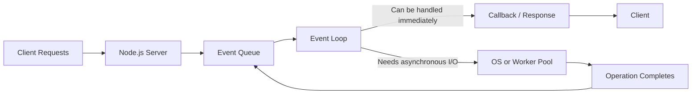
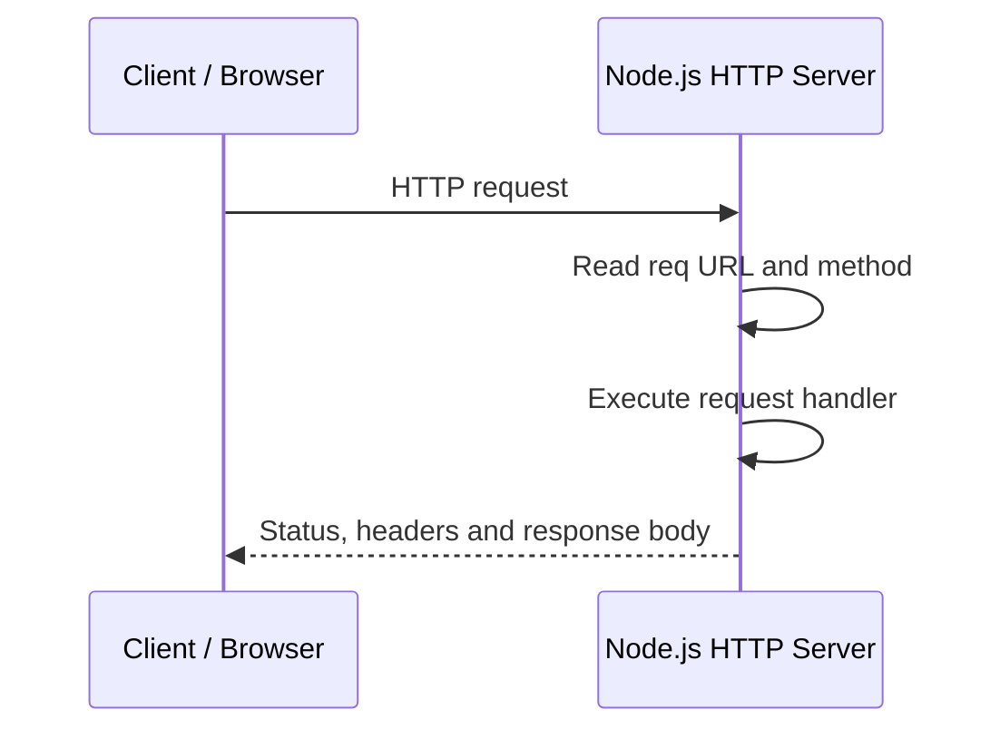
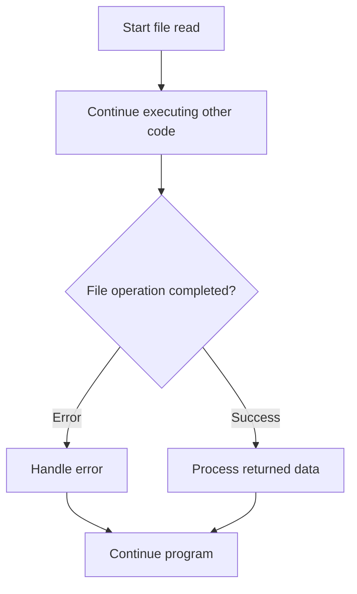

# Node.js Complete Notes
## MSc Computer Applications — Study Notes

> **Source:** Prepared from the uploaded `nodejs.pdf` lecture material (58 pages). The notes follow the topics and terminology used in the slides. Some older APIs/tools shown in the slides are marked as legacy where relevant.

---

## Contents

1. Introduction to Node.js
2. Features and Uses
3. Node.js Architecture
4. Node.js Basics and REPL
5. Modules in Node.js
6. HTTP Module
7. File System (`fs`) Module
8. URL Module and Query Strings
9. Callbacks
10. EventEmitter
11. Streams
12. Express Framework
13. Debugging
14. Quick Revision Tables
15. Exam-Oriented Questions

---

## 1. Introduction to Node.js

**Node.js** is an open-source, cross-platform JavaScript runtime environment that allows JavaScript to run outside a web browser, commonly on servers.

The lecture notes summarize it as:

**Node.js = Runtime Environment + JavaScript Library**

Node.js uses JavaScript on the server and provides built-in modules that simplify application development.

### What can Node.js do?

- Generate dynamic page content.
- Create, open, read, write, rename and delete server-side files.
- Collect form data.
- Add, delete and modify database data when used with a suitable database driver.
- Build HTTP servers and APIs.

A Node.js source file generally uses the `.js` extension and is executed with the Node.js runtime.

### Features

| Feature | Explanation |
|---|---|
| Asynchronous and event-driven | Operations such as I/O can complete without blocking the main JavaScript execution flow. |
| Fast | Uses the V8 JavaScript engine. |
| Single main JavaScript thread | The event loop handles callbacks while certain I/O work is handled by the operating system or a worker pool. |
| Scalable | Non-blocking I/O helps the server handle many concurrent connections. |
| No unnecessary buffering | Streams can process data in chunks rather than loading an entire file into memory. |

### Common use cases

- I/O-bound applications
- Data-streaming applications
- Real-time applications
- JSON-based APIs
- Single-page application backends

Node.js is often a good fit for I/O-heavy applications. CPU-intensive tasks that block the event loop require special care.

---

## 2. Node.js Architecture

The lecture slide on **page 5** illustrates requests entering a Node.js server, an event queue and event loop, and a thread pool used for certain operations such as file-system work.

### Architecture diagram



### How it works

1. A client sends a request.
2. Node.js receives and processes the request.
3. If the operation can be completed without waiting, the corresponding code runs.
4. For asynchronous I/O, Node.js delegates work to the operating system or an appropriate worker pool.
5. When the operation completes, its callback or continuation is scheduled.
6. The event loop runs the callback when it can, and the response is sent.

**Important:** “Single-threaded” does not mean every operation runs on one thread. JavaScript callbacks normally run on the main thread, while some I/O and native operations use OS facilities or a worker pool.

---

## 3. Node.js Basics

### 3.1 JavaScript data types

The slides list these types:

- String
- Number
- Boolean
- Undefined
- Null
- RegExp

Objects, arrays and functions are also important JavaScript values. `RegExp` is an object type in JavaScript rather than a primitive type.

```js
const studentName = "Riya";  // String
const age = 22;              // Number
const isStudent = true;      // Boolean
let result;                  // Undefined
const value = null;          // Null
const pattern = /node/i;     // RegExp
```

### 3.2 Object literal

An object stores related values as properties.

```js
const obj = {
  authorName: "Ryan Dahl",
  language: "Node.js"
};

console.log(obj.language);
```

### 3.3 Functions

Functions are first-class values in JavaScript. They can be assigned to variables, passed to other functions and returned from functions.

```js
function display(x) {
  console.log(x);
}

display(100);
```

### 3.4 Buffer

A **Buffer** represents binary data. It is useful when working with files, network packets and other binary streams.

```js
const data = Buffer.from("Hello");
console.log(data);
console.log(data.toString());
```

### 3.5 `process` object

Each Node.js application runs in a process. The global `process` object provides information and control related to that process.

```js
console.log(process.version);
console.log(process.platform);
console.log(process.argv);
```

### 3.6 REPL

**REPL** means **Read–Eval–Print Loop**. It lets users enter JavaScript expressions interactively in a terminal.

Start it by running:

```bash
node
```

Commands shown in the lecture slides:

| REPL command / key | Purpose |
|---|---|
| `.help` | Show available commands |
| Up / Down arrows | Navigate command history |
| `.save filename` | Save the session |
| `.load filename` | Load a file into the session |
| `Ctrl + C` | Cancel the current input |
| `Ctrl + C` twice or `Ctrl + D` | Exit the REPL |
| `.break` / `.clear` | Break out of a multiline expression |

---

## 4. Modules in Node.js

A **module** is a reusable unit of code. It helps split an application into separate files and keeps functionality organized.

The lecture notes describe three module types:

1. **Core modules** — supplied with Node.js.
2. **Local modules** — created in the application.
3. **Third-party modules** — installed from a package registry, commonly with npm.

### 4.1 Common core modules

| Module | Purpose |
|---|---|
| `http` | Create HTTP servers and work with HTTP requests/responses |
| `url` | Parse and work with URLs |
| `querystring` | Work with query-string data; older API |
| `path` | Work with file-system paths |
| `fs` | Read, write and manage files |
| `util` | Utility functions |

### 4.2 Loading a module with `require()`

The lecture uses the CommonJS module system.

```js
const fs = require("fs");
```

The value returned by `require()` depends on what the module exports.

### 4.3 Creating a local module

**Log.js**

```js
const log = {
  info(message) {
    console.log("Info: " + message);
  },
  warning(message) {
    console.log("Warning: " + message);
  },
  error(message) {
    console.log("Error: " + message);
  }
};

module.exports = log;
```

**app.js**

```js
const myLogModule = require("./Log.js");

myLogModule.info("Node.js started");
myLogModule.warning("Low disk space");
myLogModule.error("Unable to connect");
```

`module.exports` defines the value made available to other files through `require()`.

### 4.4 Exporting different values

**Export a string**

```js
// message.js
module.exports = "Hello World";
```

```js
// app.js
const message = require("./message.js");
console.log(message);
```

**Export an object**

```js
// data.js
module.exports = {
  firstName: "James",
  lastName: "Bond"
};
```

```js
const person = require("./data.js");
console.log(person.firstName + " " + person.lastName);
```

**Export a function**

```js
// logger.js
module.exports = function (message) {
  console.log(message);
};
```

```js
const log = require("./logger.js");
log("Hello World");
```

**Export a constructor function**

```js
// Person.js
function Person(firstName, lastName) {
  this.firstName = firstName;
  this.lastName = lastName;
  this.fullName = function () {
    return this.firstName + " " + this.lastName;
  };
}

module.exports = Person;
```

```js
const Person = require("./Person.js");
const person1 = new Person("James", "Bond");
console.log(person1.fullName());
```

### `exports` versus `module.exports`

- `module.exports` is the actual exported value.
- `exports` initially refers to the same object, so adding properties such as `exports.name = "Riya"` works.
- Reassigning `exports` alone does not replace the exported value. To export a new function or primitive directly, assign it to `module.exports`.

---

## 5. HTTP Module

The built-in `http` module allows a Node.js program to create an HTTP server.

### 5.1 Basic HTTP server

```js
const http = require("http");

const server = http.createServer((req, res) => {
  res.write("Hello World!");
  res.end();
});

server.listen(8080, () => {
  console.log("Server running at http://localhost:8080");
});
```

### Explanation

- `require("http")` loads the HTTP module.
- `createServer()` creates a server and registers a request handler.
- `req` represents the incoming request.
- `res` is used to build and send the response.
- `res.end()` finishes the response.
- `listen(8080)` tells the server to listen on port 8080.

### 5.2 Sending a response with a header

```js
const http = require("http");

http.createServer((req, res) => {
  res.writeHead(200, { "Content-Type": "text/html; charset=utf-8" });
  res.end("<h1>Hello World!</h1>");
}).listen(8080);
```

`200` is the HTTP status code meaning the request succeeded. `Content-Type` tells the client how to interpret the response body.

### 5.3 Reading the requested URL

```js
const http = require("http");

http.createServer((req, res) => {
  res.writeHead(200, { "Content-Type": "text/plain" });
  res.end("Requested URL: " + req.url);
}).listen(8080);
```

For example, a request to `/about` makes `req.url` contain `/about` (including the query string if one is present).

### 5.4 Reading query parameters

The slides use the older `url.parse()` API. A modern alternative is the WHATWG `URL` API:

```js
const http = require("http");

http.createServer((req, res) => {
  const requestUrl = new URL(req.url, "http://localhost:8080");
  const year = requestUrl.searchParams.get("year");
  const month = requestUrl.searchParams.get("month");

  res.writeHead(200, { "Content-Type": "text/plain; charset=utf-8" });
  res.end(`Year: ${year}, Month: ${month}`);
}).listen(8080);
```

Example request:

```text
http://localhost:8080/?year=2026&month=October
```

The query parameters are `year=2026` and `month=October`.

### HTTP request flow



---

## 6. File System (`fs`) Module

The `fs` module lets Node.js work with files and directories.

```js
const fs = require("fs");
```

Common operations:

- Read files
- Create or write files
- Append content
- Open and close files
- Rename files
- Delete files
- Read and create directories
- Inspect file information

### 6.1 Read a file asynchronously

```js
const fs = require("fs");

fs.readFile("input.txt", "utf8", (err, data) => {
  if (err) {
    console.error(err);
    return;
  }

  console.log(data);
});
```

`readFile()` reads the file asynchronously. The callback receives an error, if one occurred, and the file data.

### 6.2 Write a file

```js
const fs = require("fs");

fs.writeFile("output.txt", "Node.js file system example", "utf8", (err) => {
  if (err) {
    console.error(err);
    return;
  }

  console.log("File written successfully.");
});
```

`writeFile()` creates the file if it does not exist and replaces its contents if it does.

### 6.3 Append to a file

```js
const fs = require("fs");

fs.appendFile("output.txt", "\nNew line added.", "utf8", (err) => {
  if (err) {
    console.error(err);
    return;
  }

  console.log("Content appended.");
});
```

### 6.4 Delete a file

```js
const fs = require("fs");

fs.unlink("output.txt", (err) => {
  if (err) {
    console.error(err);
    return;
  }

  console.log("File deleted.");
});
```

### 6.5 Rename a file

```js
const fs = require("fs");

fs.rename("old.txt", "new.txt", (err) => {
  if (err) {
    console.error(err);
    return;
  }

  console.log("File renamed.");
});
```

### 6.6 Read directory contents

```js
const fs = require("fs");

fs.readdir(".", (err, files) => {
  if (err) {
    console.error(err);
    return;
  }

  console.log(files);
});
```

### 6.7 Open-file flags

The lecture's table on **page 38** lists common flags:

| Flag | Meaning |
|---|---|
| `r` | Read; error if file does not exist |
| `r+` | Read and write; error if file does not exist |
| `w` | Write; create or truncate the file |
| `w+` | Read and write; create or truncate the file |
| `wx` | Write, but fail if the path already exists |
| `a` | Append; create the file if needed |
| `a+` | Read and append; create the file if needed |
| `ax` | Append, but fail if the path already exists |

The slides also list `rs`, `rs+`, `wx+` and `ax+`; these are less commonly needed for basic programs.

### 6.8 Important `fs` methods

| Method | Purpose |
|---|---|
| `fs.readFile()` | Read a file |
| `fs.writeFile()` | Write or replace file content |
| `fs.appendFile()` | Append content |
| `fs.open()` | Open a file using a specified flag |
| `fs.rename()` | Rename or move a file |
| `fs.unlink()` | Delete a file |
| `fs.stat()` | Obtain file statistics |
| `fs.mkdir()` | Create a directory |
| `fs.readdir()` | Read directory contents |
| `fs.rmdir()` | Remove a directory (legacy API in many versions) |
| `fs.access()` | Check accessibility/permissions |

**Exam point:** `fs.readFile()` is asynchronous. Node.js also provides synchronous methods such as `fs.readFileSync()`, which block execution while the operation runs.

---

## 7. URL Module and Query Strings

A URL identifies a resource and may include a protocol, host, port, path and query string.

Example:

```text
https://example.com:8080/products?category=books&page=2
```

| Part | Value |
|---|---|
| Protocol | `https:` |
| Host | `example.com:8080` |
| Path | `/products` |
| Query parameters | `category=books`, `page=2` |

### Example using the modern URL API

```js
const url = new URL(
  "https://example.com/products?category=books&page=2"
);

console.log(url.hostname);                    // example.com
console.log(url.pathname);                    // /products
console.log(url.searchParams.get("category")); // books
console.log(url.searchParams.get("page"));     // 2
```

The lecture uses `url.parse(req.url, true).query` to extract query values. That syntax may appear in the source slides, but the WHATWG `URL` API is preferred in modern code.

---

## 8. Callbacks

A **callback** is a function passed to another function so that it can be called later, often when an operation finishes.

Node.js frequently uses callbacks for asynchronous I/O.

### Example

```js
const fs = require("fs");

fs.readFile("input.txt", "utf8", (err, data) => {
  if (err) {
    console.error("Read failed:", err.message);
    return;
  }

  console.log(data);
});

console.log("The read request has been started.");
```

The final `console.log()` can run before the file-reading callback. This demonstrates that the file operation does not block the main flow.

### Callback flowchart



### Error-first callback pattern

Many Node.js callbacks use the first argument for an error:

```js
function callback(err, data) {
  if (err) {
    // Handle the error
    return;
  }

  // Use data
}
```

Always handle errors rather than assuming an asynchronous operation succeeds.

---

## 9. EventEmitter

Node.js provides the `events` module to create and handle custom events.

### 9.1 Creating an EventEmitter

```js
const EventEmitter = require("events");

const eventEmitter = new EventEmitter();

eventEmitter.on("greet", (name) => {
  console.log(`Hello, ${name}`);
});

eventEmitter.emit("greet", "Riya");
```

- `on(event, listener)` registers a listener.
- `emit(event, ...args)` fires an event and passes arguments to its listeners.

### Event flow

```mermaid
flowchart TD
    A[Create EventEmitter] --> B[Register listener with on()]
    B --> C[Emit event with emit()]
    C --> D[Listener function runs]
```

### 9.2 Important EventEmitter methods

| Method | Purpose |
|---|---|
| `addListener(event, listener)` | Add a listener |
| `on(event, listener)` | Add a listener; commonly used |
| `once(event, listener)` | Run a listener only once |
| `emit(event, ...args)` | Trigger an event |
| `removeListener(event, listener)` | Remove a specified listener |
| `removeAllListeners(event)` | Remove listeners for an event, or all listeners |
| `listeners(event)` | Get the listeners for an event |
| `setMaxListeners(n)` | Set the listener warning threshold |
| `listenerCount(event)` | Get the number of listeners for an event |

### 9.3 `on()` versus `once()`

```js
eventEmitter.on("normal", () => console.log("Can run repeatedly"));
eventEmitter.once("single", () => console.log("Runs only once"));
```

A listener registered with `on()` remains registered until removed. A `once()` listener removes itself after its first invocation.

### 9.4 Common events mentioned in the slides

- `newListener` — emitted when a listener is added.
- `removeListener` — emitted when a listener is removed.
- `error` — used to report errors; emitting `error` without a suitable listener can cause the process to throw.

---

## 10. Streams

A **stream** is an interface for reading data from a source or writing data to a destination, often in chunks. Streams are useful for large files and continuous data because the whole dataset does not need to be loaded into memory at once.

### Four types of streams

| Type | Purpose |
|---|---|
| Readable | Read data |
| Writable | Write data |
| Duplex | Read and write data |
| Transform | Duplex stream that transforms data as it passes through |

Streams are EventEmitters and emit events during their lifecycle.

### Common stream events

| Event | Meaning |
|---|---|
| `data` | A chunk of data is available |
| `end` | No more data will be provided by a readable stream |
| `error` | An error occurred |
| `finish` | All data has been flushed for a writable stream |

### 10.1 Read from a file using a readable stream

```js
const fs = require("fs");

const readerStream = fs.createReadStream("input.txt", {
  encoding: "utf8"
});

readerStream.on("data", (chunk) => {
  console.log("Received chunk:", chunk);
});

readerStream.on("end", () => {
  console.log("Reading completed.");
});

readerStream.on("error", (err) => {
  console.error("Stream error:", err.message);
});
```

This example prints chunks as they arrive instead of first collecting the complete file into one string.

### 10.2 Write to a file using a writable stream

```js
const fs = require("fs");

const writerStream = fs.createWriteStream("output.txt");

writerStream.write("A solution of all technology\n", "utf8");
writerStream.end("Writing completed.");

writerStream.on("finish", () => {
  console.log("All data written.");
});

writerStream.on("error", (err) => {
  console.error("Stream error:", err.message);
});
```

`end()` signals that no more data will be written. The `finish` event is emitted when the writable stream has finished processing the data.

---

## 11. Express Framework

**Express** is a web application framework built on top of Node.js. The lecture slides describe it as a flexible framework for web and mobile applications.

### Core features listed in the slides

- Supports single-page, multi-page and hybrid applications.
- Provides middleware for handling requests.
- Defines routes based on HTTP methods and URLs.
- Supports dynamic rendering of HTML using templates.

### Simple Express server

```js
const express = require("express");
const app = express();

app.get("/", (req, res) => {
  res.send("Hello from Express!");
});

app.get("/about", (req, res) => {
  res.send("About page");
});

app.listen(3000, () => {
  console.log("Server running on http://localhost:3000");
});
```

Install Express in a project first:

```bash
npm init -y
npm install express
```

### Node.js versus Express

| Node.js | Express |
|---|---|
| JavaScript runtime environment | Web framework that runs on Node.js |
| Provides built-in modules such as `http` and `fs` | Adds convenient routing and middleware |
| Can create a server without an external framework | Simplifies common web-server tasks |

---

## 12. Debugging Node.js Applications

Debugging means finding and correcting errors in a program.

The slides discuss:

- Core Node.js debugger
- Node Inspector
- Debugging support in IDEs

They show the `debugger;` statement and older commands such as `node debug app.js`. These are legacy approaches and may not work in current Node.js releases.

### Practical modern approach

Use the Node.js inspector:

```bash
node --inspect-brk app.js
```

Then attach a supported debugger, such as the debugger in Visual Studio Code or Chrome DevTools, according to the runtime's instructions.

### General debugging steps

1. Reproduce the problem.
2. Read the error message and stack trace.
3. Set a breakpoint near the suspected line.
4. Inspect variables and the call stack.
5. Step through the code.
6. Correct the cause and test again.

---

## 13. Quick Revision Tables

### Core module recap

| Module | One-line use |
|---|---|
| `http` | Create HTTP servers |
| `fs` | File-system operations |
| `url` / `URL` | Parse and inspect URLs |
| `path` | Work with file paths |
| `events` | Create event emitters |
| `util` | Utility functions |
| `querystring` | Parse/build query strings; older API in many use cases |

### Key comparisons

| Concept A | Concept B | Difference |
|---|---|---|
| Synchronous I/O | Asynchronous I/O | Synchronous waits for the operation; asynchronous lets other work proceed while waiting. |
| `on()` | `once()` | `on()` can run repeatedly; `once()` runs at most once per registration. |
| `writeFile()` | `appendFile()` | `writeFile()` replaces existing contents; `appendFile()` adds to the end. |
| Readable stream | Writable stream | Readable supplies data; writable accepts data. |
| `module.exports` | `exports` | `module.exports` is the exported value; `exports` is initially a reference to it. |
| Node.js | Express | Runtime versus web framework. |

### Important syntax to remember

```js
const http = require("http");
const fs = require("fs");
const EventEmitter = require("events");

http.createServer((req, res) => {
  res.end("Hello");
}).listen(8080);

fs.readFile("input.txt", "utf8", (err, data) => {
  if (err) return console.error(err);
  console.log(data);
});

const emitter = new EventEmitter();
emitter.on("ready", () => console.log("Ready"));
emitter.emit("ready");
```

---

## 14. Exam-Oriented Questions

### Short-answer questions

1. Define Node.js.
2. List four features of Node.js.
3. What is the event loop?
4. What is a Node.js module? Name the three module types in the lecture notes.
5. What is the purpose of `require()`?
6. Explain `module.exports`.
7. What is the purpose of the HTTP module?
8. Define callback function.
9. What is the File System module?
10. Define Buffer.
11. What is EventEmitter?
12. What is a stream? Name its four types.
13. What is Express?
14. What is REPL? Expand the abbreviation.

### Long-answer / diagram questions

1. Explain Node.js architecture with a neat diagram.
2. Explain core, local and third-party modules with examples.
3. Write a Node.js program to create an HTTP server.
4. Explain the File System module and its important methods.
5. Explain EventEmitter methods with a program.
6. Explain callbacks and asynchronous file reading.
7. Explain the four types of streams with examples.
8. Explain Express and list its features.
9. Explain how URL query parameters can be read in a Node.js server.
10. Describe the steps used to debug a Node.js application.

### Practical questions

1. Write a program to display “Hello World” using an HTTP server.
2. Write a program to read a text file asynchronously.
3. Write a program to write text to a file.
4. Write a program to append text to a file.
5. Write a program to rename and delete a file.
6. Create a local logging module and import it into `app.js`.
7. Create an EventEmitter that emits a `welcome` event.
8. Read a file using a readable stream.
9. Write content to a file using a writable stream.
10. Create an Express application with `/` and `/about` routes.

---

## 15. Study Notes and Source Alignment

- The architecture diagram is based on the Node.js architecture figure on **page 5**.
- The core-module table follows the lecture table on **page 17**.
- File operation methods and open flags are summarized from **pages 34–41**.
- EventEmitter methods and events are summarized from **pages 47–53**.
- Callback and stream definitions and examples follow **pages 54–57**.
- The source slides use some older Node.js APIs and debugging tools. Where indicated, a current alternative is included so the example is more likely to work in a modern Node.js environment.

**End of notes.**
